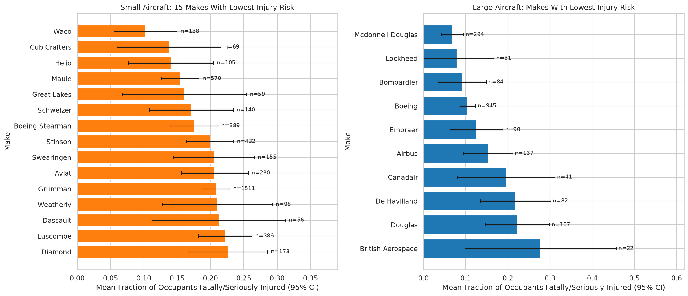
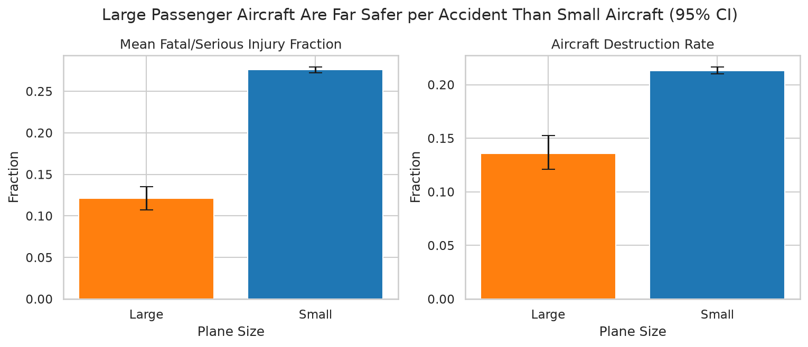
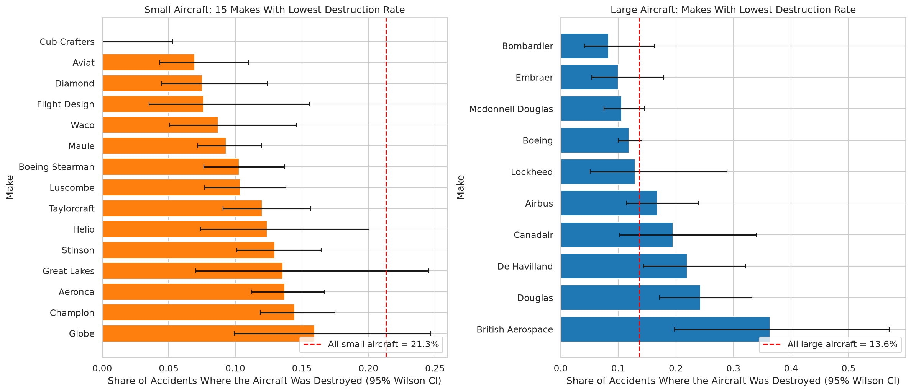
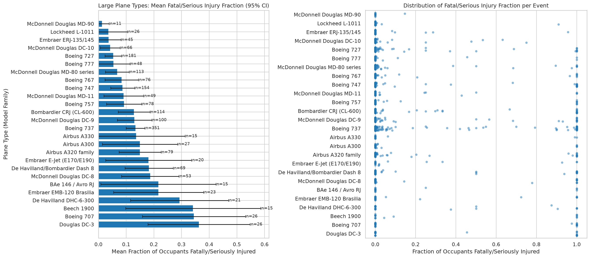
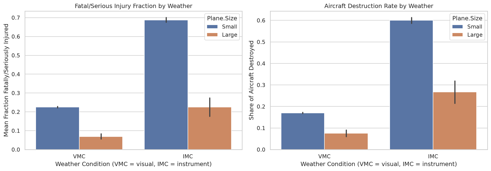
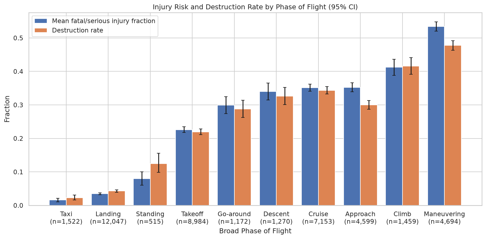

# Aviation Accident Analysis: Lowest-Risk Aircraft for an Aviation Insurer



## Business Problem

An airline/airplane insurer wants to know which aircraft **makes and models** have the **lowest likelihood of fatal or serious injuries** and the **lowest rate of total destruction** when an accident happens, and which **operating conditions** drive those outcomes. The client asked for:

- professional-build airplanes that could still be active, assuming a 40-year service life (**events from 1983 onwards**),
- **separate recommendations for small aircraft and larger passenger aircraft**,
- claims that are **statistically robust**, with enough samples behind every comparison.

## Data

The NTSB aviation accident database, from the Kaggle dataset "acidentes-de-aviao-at-2023" (`data/AviationData.csv`), covers 88,889 civil aviation accidents and incidents, with event dates from 1948 to December 2022. After filtering to professional-build airplanes from 1983 onwards, cleaning and dropping records without usable injury or damage information, **60,240 events** remain (`data/AviationData_cleaned.csv`).

## Methods

**Cleaning** (`Aviation_Accidents_Cleaning.ipynb`)
- Filtered by date (1983+) and to professional builds (`Amateur.Built == "No"`).
- `Aircraft.Category` was 64% missing. It was imputed from the most common category for the same make/model, then the same make, and only airplanes were kept.
- **Derived metrics:**
  - `Total.Passengers` = fatal + serious + minor + uninjured.
  - `Fatal.Serious.Fraction` = (fatal + serious) / total aboard. This is the likelihood that an occupant is seriously or fatally injured.
  - `Destroyed` = 1 if the aircraft was destroyed. Its mean is the destruction rate.
- `Make` was normalized for capitalization, punctuation, corporate suffixes and aliases. That reduced 1,351 spellings to 803 makes, and makes with at least 50 events were kept. `Make.Model` was created as a unique plane-type key, because model labels are shared across makes.
- Standardized `Weather.Condition`, `Engine.Type`, `Number.of.Engines`, `Purpose.of.flight` and `Broad.phase.of.flight`. Dropped columns that were more than 50% missing.

**Analysis** (`Aviation_Accidents_Data_Analysis.ipynb`)
- Plane types were classed as **Large** when their typical occupancy (90th percentile of people aboard) is above **20** and they are multi-engine.
- Airliner model labels were grouped into families (for example, all 737 variants) so that each type has enough events.
- Minimum samples:
  - small makes: 50 events,
  - large makes: 20 events,
  - plane types: 10 events. Recommendations favor types with 100 or more events.
- Every rate is reported with a **95% confidence interval**. Mean ± 1.96·SE is used for injury fractions, and the Wilson interval for destruction rates.
- Group differences were tested with Welch t-tests, chi-square tests and Kruskal-Wallis tests.

## Results



Large passenger aircraft accidents are much less severe than small-aircraft accidents. About 12% of occupants are seriously or fatally injured, against 28%, and about 14% of large aircraft are destroyed, against 21%.

### Small aircraft
| Make | Events | Fatal/serious fraction (95% CI) | Destroyed rate (95% CI) |
|---|---|---|---|
| **Maule** | 570 | 0.155 (0.126–0.183) | 9.3% (7.2–12.0%) |
| **Aviat** | 230 | 0.207 (0.156–0.257) | 7.0% (4.3–11.0%) |
| **Diamond** | 173 | 0.226 (0.167–0.286) | 7.5% (4.4–12.4%) |
| **Cub Crafters** | 69 | 0.138 (0.060–0.216) | 0.0% (0.0–5.3%) |
| *All small aircraft* | 58,373 | 0.276 | 21.3% |

The best common small plane types (at least 100 events) are the **Cessna 172S/172R** (about 7% destroyed), the **Cessna 180/185** and the **Piper PA-18 Super Cub**.



### Large aircraft
| Make / Type | Events | Fatal/serious fraction (95% CI) | Destroyed rate (95% CI) |
|---|---|---|---|
| **Boeing** (make) | 945 | 0.105 (0.086–0.124) | 11.9% (9.9–14.1%) |
| **McDonnell Douglas** (make) | 294 | 0.069 (0.042–0.095) | 10.5% (7.5–14.6%) |
| Boeing 777 | 48 | 0.055 (0.000–0.114) | 8.3% (3.3–19.6%) |
| Boeing 767 | 76 | 0.084 (0.024–0.145) | 9.2% (4.5–17.8%) |
| Boeing 757 | 78 | 0.093 (0.029–0.157) | 7.7% (3.6–15.8%) |
| Embraer ERJ-135/145 | 45 | 0.037 (0.000–0.082) | 0.0% (0.0–7.9%) |
| *All large aircraft* | 1,867 | 0.121 | 13.6% |



### Factors that drive severity

- **Weather:** accidents in instrument conditions (IMC) are about **3 times as severe** for small aircraft: 69% vs 23% of occupants seriously or fatally injured, and 60% vs 17% destroyed (p < 1e-300).
- **Phase of flight:** taxi and landing accidents are frequent but minor (2–4% injury fraction). **Maneuvering** (53%) and **climb** (41%) accidents are the most catastrophic.
- **Engines:** small **twin-engine** aircraft have *more* severe accidents than single-engine ones (32% vs 19% destroyed, p ≈ 4e-148). Small turbojets are the most severe engine type.
- **Purpose:** instructional flights are the least severe, and business and aerial-observation flights are the most severe.



## Recommendations
1. **Small aircraft:** prioritize **Maule** (the strongest evidence), **Aviat**, **Diamond** and **Cub Crafters**. In the high-volume segment, prioritize the **Cessna 172S/172R**, the **Cessna 180/185** and the **Piper PA-18**.
2. **Large aircraft:** prioritize **Boeing widebodies (777, 767, 747) and the 757**. For regional operators, prioritize the **Embraer ERJ-135/145**. Surcharge older or turboprop types (707, DC-3, Beech 1900, DHC-6, EMB-120, BAe 146).
3. **Underwrite operating conditions:** add premiums for instrument-weather exposure, low-level maneuvering missions (agricultural, observation, aerobatic) and high-performance twins or turbojets.

## Limitations and Next Steps
- The dataset contains only accidents, so it measures **severity when an accident happens**, not accident **frequency**. The next step is to combine these results with FAA fleet-size and flight-hour data to estimate accident rates.
- The number of people aboard is estimated from the injury columns. Cargo and ferry flights with few people aboard can produce extreme fractions.
- Types with fewer than about 100 events have wide confidence intervals and should be treated as provisional.

## Repository Structure
```
├── README.md
├── Aviation_Accidents_Cleaning.ipynb       # loading, filtering, cleaning, derived metrics
├── Aviation_Accidents_Data_Analysis.ipynb  # EDA, statistics, recommendations
├── data/
│   ├── AviationData.csv                    # raw NTSB data
│   ├── AviationData_cleaned.csv            # output of the cleaning notebook
│   └── USState_Codes.csv
└── images/                                 # figures exported by the analysis notebook
```

To reproduce, run `Aviation_Accidents_Cleaning.ipynb` and then `Aviation_Accidents_Data_Analysis.ipynb` (Python 3 with pandas, numpy, matplotlib, seaborn and scipy).
